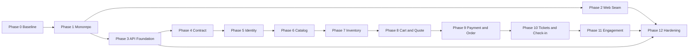

# 11 — Fullstack Migration Implementation Plan

**Status:** READY FOR EXECUTION — phase-gated  
**Date:** 2026-11-10  
**Audience:** implementation agents, reviewers, and the lead integrator  
**Scope:** migrate the existing Eventra frontend-only showcase into a production-capable fullstack application without rewriting the UI.

> **For agentic workers:** Read `AGENTS.md`, this document, and the relevant architecture document before touching code. Use `superpowers:subagent-driven-development` for execution. Use `superpowers:writing-plans` only if a phase needs a more detailed sub-plan. Do not implement a phase until the lead has approved its task packet. Do not edit baseline architecture documents without an approved decision-log entry.

---

## 1. Document Control

| Item                               | Value                                                                                |
| ---------------------------------- | ------------------------------------------------------------------------------------ |
| Baseline product docs              | `docs/00`–`docs/16`                                                                  |
| Fullstack architecture             | `docs/fullstack-architecture/00`–`docs/fullstack-architecture/10`                    |
| This plan                          | `docs/fullstack-architecture/11-implementation-plan.md`                              |
| Current repository commit at audit | `e85aec6` plus uncommitted docs/AGENTS changes                                       |
| Current frontend status            | Frontend-only showcase, all data in browser                                          |
| Target                             | Monorepo, Go API, MySQL authority, Redis cache, S3-compatible storage, Docker, CI/CD |
| Payment in first release           | Mock provider behind a payment adapter                                               |
| Authentication                     | JWT access/refresh cookies, RBAC, organization ownership, guest principal            |
| Frontend data mode                 | API-only at runtime; mock adapters are test-only                                     |

### 1.1 How to use this document

1. Read the phase's section and its prerequisite phases.
2. Create a task packet for each task using §14.
3. Implement one task at a time with TDD.
4. Run the phase verification commands.
5. Produce the phase report using §15.
6. Stop and wait for explicit approval before the next phase.

### 1.2 Approval policy

- Phase 0 through Phase 12 are sequential gates.
- A phase is complete only after implementation, verification, report, and explicit lead approval.
- A failed gate blocks the next phase.
- Scope changes require a decision-log entry and an updated plan.
- No production deployment is allowed before Phase 12's release gate passes.

---

## 2. Executive Summary

Eventra currently has a complete, polished Next.js frontend with customer and organizer surfaces, but every business rule is simulated in the browser. The migration keeps the UI and replaces the data authority behind it.

The migration has four structural realities:

1. The current repository has **no repository/service layer**. `src/services/mock` and `src/services/repositories` are empty, and pages import Zustand stores and seed data directly. The plan therefore adds a frontend data-access seam before API integration.
2. The current inventory is **not authoritative**. General-admission `soldCount` is never incremented after checkout, seats are not reserved, and the same seat can be added to the cart repeatedly. The backend inventory model must be designed from the documented invariants, not ported from the frontend.
3. The current checkout is **client-authoritative**. Totals use cart price snapshots, there is no reservation, no idempotency key, no payment entity, and no webhook. The backend must recalculate every quote and confirm payment only from a verified provider event.
4. The current authorization is **UX-only**. Organizer access is a client-side role check. The backend must enforce permissions, organization membership, and resource ownership on every query and mutation.

The plan is intentionally incremental. Each phase must leave the application runnable, tested, and reviewable.

---

## 3. Approved Decisions

These decisions are approved for execution. Do not change them silently.

| ID  | Decision                         | Approved Value                                                                                                                                                                                                                                           | Why It Matters                                                             |
| --- | -------------------------------- | -------------------------------------------------------------------------------------------------------------------------------------------------------------------------------------------------------------------------------------------------------- | -------------------------------------------------------------------------- |
| D1  | Documentation and release target | Freeze fullstack architecture v1.0 as the baseline. Target production-capable fullstack with mock payment and staging readiness. Real vendors are selected before hardening.                                                                             | Prevents scope drift and keeps infrastructure work behind adapters.        |
| D2  | Runtime data mode                | One API runtime backed by a seeded database. Mock adapters are test-only. No silent localStorage fallback.                                                                                                                                               | Removes dual-authority bugs and makes production behavior honest.          |
| D3  | Cart and guest ownership         | Server-side cart for guest and authenticated users. Guest principal is an opaque HttpOnly cookie whose secret is hashed at rest. Guest retention is 30 days. Local UI state is optimistic only.                                                          | Makes cart, quote, reservation, and order ownership consistent.            |
| D4  | Inventory model                  | GA uses `inventory_buckets` with row locks. Reserved seating uses a current-state `seat_claims` table with unique `(event_id, seat_id)` plus reservation/history tables. Reservation TTL is 10 minutes. An expiry worker releases capacity exactly once. | Prevents oversell, duplicate seats, and stale holds.                       |
| D5  | Frontend server state            | TanStack Query plus repository adapters plus a generated OpenAPI client. Zustand remains for UI-only state.                                                                                                                                              | Separates server authority from UI state and removes ad-hoc fetch caching. |
| D6  | Identifiers                      | ULID `CHAR(26)` for internal entity IDs. Human-readable `order_number` is a separate field.                                                                                                                                                              | Keeps IDs opaque, sortable, and simple in MySQL.                           |
| D7  | Auth/security defaults           | HS256 access JWT, 15-minute TTL. Rotating refresh token, 30-day TTL. Argon2id credentials. CSRF double-submit plus Origin validation. Cookies: `HttpOnly`, `SameSite=Lax`, `Secure` on HTTPS.                                                            | Provides a complete, testable browser session model for a single API.      |
| D8  | Seed and local data              | Seed the database with the current 24 events, 8 categories, 10 venues, 3 organizer profiles, 2 users, and 11 orders/tickets. Discard browser localStorage on cutover. Reset = re-seed the database.                                                      | Preserves the showcase while avoiding untrusted local-data migration.      |
| D9  | Check-in scope                   | Event-scoped check-in with `checkin:write` permission, organization ownership, and atomic `VALID → USED`.                                                                                                                                                | Prevents cross-event and cross-organization ticket use.                    |
| D10 | Baseline repository              | Commit `docs/fullstack-architecture` and `AGENTS.md`, run the baseline checks, and tag `baseline-frontend` before Phase 1.                                                                                                                               | Gives every agent a reproducible starting point.                           |
| D11 | Vendors and versions             | Defer payment/email/S3/observability vendor selection until the owning phase. Use mock payment, local MinIO/S3-compatible storage, and structured logs first. Pin Go `1.27.3`, Node `26.13.0` LTS, MySQL `8.4` LTS, Redis `8.x`.                         | Avoids blocking vertical slices on procurement.                            |

### 3.1 Documentation refinements

These are plan-level corrections, not scope changes:

- `docs/05-database-design.md` omits a wishlist table while `docs/06-api-contract.md` includes wishlist in account endpoints. This plan adds `wishlist_items`.
- `docs/02` and `docs/10` refer to replacing mock repositories behind existing interfaces. The repository currently has no such interfaces. Phase 2 creates them.
- The docs' migration sequence does not include a frontend data-access seam. Phase 2 adds it because the current UI directly imports stores and seed data.
- The docs' phase order places catalog before inventory and checkout. This plan preserves that order and splits checkout/payment into separate gates.

---

## 4. Current Baseline

### 4.1 Verified baseline evidence

| Check               | Result                                  |
| ------------------- | --------------------------------------- |
| `npm run typecheck` | PASS                                    |
| `npm run lint`      | PASS, 123 files, 0 diagnostics          |
| `npm run test:run`  | PASS, 3 files, 19 tests                 |
| `npm run build`     | PASS, 39 route entries                  |
| `npm run test:e2e`  | PASS, 23 tests: 17 Chromium + 6 Firefox |

### 4.2 Repository facts

- Next.js `16.4.6`, React `19.3.0`, TypeScript, App Router.
- Tailwind `4.3.3` via `@tailwindcss/turbopack`; no `tailwind.config`.
- Zustand `5.1.0`, next-intl, Radix UI, Recharts, react-qr-code, Sonner.
- Vitest, Playwright, Biome.
- npm lockfile v3.
- Local Node `26.9.0`, npm `11.19.1`; target Node `26.13.0` LTS.
- Local Go `1.22.2`; target Go `1.27.3`.
- Docker `29.9.3`, Compose `5.7.0`, MySQL `8.0.46`, Redis `8.10.3`.
- 35 `page.tsx`, 5 `layout.tsx`.
- 0 API routes, 0 server actions, 0 middleware.
- `src/services/mock` and `src/services/repositories` are empty.
- 36 direct imports from `@/data/seed`.
- 10 Zustand stores persisted under `eventra-*` keys.
- No `.env.example`, Dockerfile, Compose file, Turbo config, or CI workflow.

### 4.3 Seed data

- 8 categories.
- 10 venues.
- 3 organizer profiles; one demo organizer owns all seed events.
- 2 users: customer and organizer.
- 24 events:
  - 16 `GENERAL_ADMISSION`
  - 6 `RESERVED_SEATING`
  - 2 `HYBRID`
  - 18 `PUBLISHED`, 1 `DRAFT`, 1 `PAUSED`, 1 `CANCELLED`, 3 `ENDED`
- Arena layout: 240 seats; Theater layout: 224 seats.
- 11 seed orders covering confirmed, pending, failed, and cancelled states.

### 4.4 Current behavior that must not be ported

| Current Behavior                                   | Why It Is Unsafe                           |
| -------------------------------------------------- | ------------------------------------------ |
| GA `soldCount` never increments                    | Availability never reflects purchases.     |
| Seats are not held when added to cart              | The same seat can be sold multiple times.  |
| Checkout uses `unitPriceSnapshot` from the browser | Client can alter price.                    |
| `createOrder` runs after `window.setTimeout`       | Payment/order state is client-controlled.  |
| No idempotency key                                 | Double submit can create duplicate orders. |
| QR contains `ticketCode` derived from order number | Token is guessable and not opaque.         |
| Check-in searches all tickets                      | No event or organization scope.            |
| Organizer event delete only removes the event      | Orders and tickets become orphaned.        |
| Event status can change arbitrarily                | No domain state machine.                   |
| `guest-local` owner key is shared                  | Guest orders are not truly isolated.       |

### 4.5 Baseline caveats

- `docs/fullstack-architecture/` was untracked at audit time.
- `AGENTS.md` was modified by `next dev` during the E2E baseline run; Next added `nextjs-agent-rules` and `nextjs-agent-feedback` blocks. Phase 0 must commit or revert them before Phase 1.
- Build output `.next` is gitignored.
- The current repository has no CI; all checks were local.

---

## 5. Target Architecture

### 5.1 Topology

```text
Browser
  │ HTTPS
  ▼
Reverse Proxy (Caddy)
  ├── /            → Next.js web
  └── /api/*       → Go/Gin API
                         ├── MySQL 8.4 (authoritative)
                         ├── Redis 8.x (cache, rate limit, ephemeral)
                         └── S3-compatible storage (assets, uploads)
```

Use same-site routing. Browser requests go to `/api/v1/*`; cookies are first-party. Do not put JWTs in URLs or localStorage.

### 5.2 Monorepo layout

```text
eventra/
├── apps/
│   ├── web/                        # Existing Next.js app
│   └── api/
│       ├── cmd/api/
│       ├── cmd/worker/
│       ├── internal/app/
│       ├── internal/platform/
│       ├── internal/modules/
│       ├── migrations/
│       ├── openapi/
│       └── go.mod
├── packages/
│   └── api-client/
├── infra/
│   ├── docker/
│   └── proxy/
├── docs/
├── .github/workflows/
├── docker-compose.yml
├── turbo.json
├── package.json
└── package-lock.json
```

### 5.3 Backend module boundaries

```text
identity, authorization, organization
event, venue, ticket, inventory
cart, promotion, order, payment
attendee, checkin, notification, review, analytics
```

One API binary, one deployment unit, explicit internal boundaries. Domain packages must not import Gin, GORM, Redis, or provider SDKs. HTTP DTOs must not be GORM models.

Dependency direction:

```text
HTTP handler → application use case → domain
application → repository/provider interfaces
infrastructure → implements interfaces
```

### 5.4 Data flow

```text
Page/Feature
  → repository interface
  → API adapter
  → generated client
  → Go HTTP handler
  → application use case
  → domain rules
  → repository/provider interfaces
  → MySQL / Redis / S3 / payment adapter
```

Components must not import generated OpenAPI DTOs directly. Map DTOs to frontend view models at the adapter boundary.

### 5.5 State ownership

| State                                               | Owner                   |
| --------------------------------------------------- | ----------------------- |
| Selected seats before reservation                   | Local/Zustand UI state  |
| Dialog, wizard step, hover, optimistic UI           | Local/Zustand UI state  |
| Locale and theme                                    | Client preferences      |
| Events, categories, venues                          | TanStack Query from API |
| Ticket availability                                 | TanStack Query from API |
| Cart, quote, reservation                            | TanStack Query from API |
| Orders, tickets, profile                            | TanStack Query from API |
| Organizer events, orders, attendees, analytics      | TanStack Query from API |
| Notifications, reviews, wishlist                    | TanStack Query from API |
| Price, stock, payment, ticket validity, permissions | Server authority only   |

Zustand must never be the authoritative store for server data.

### 5.6 Cache policy

- Public catalog: cacheable with short TTL and explicit invalidation.
- Auth, cart, quote, checkout, orders, tickets, organizer data, notifications: `no-store`.
- Redis: selective cache, rate limits, ephemeral reservation reminders only. Losing Redis must not corrupt business state.
- Next.js: cache public catalog responses only. Do not cache responses that depend on cookies or user identity.

### 5.7 Auth and session model

- Access cookie: `eventra_at`, HttpOnly, `SameSite=Lax`, `Secure` in production, 15 minutes.
- Refresh cookie: `eventra_rt`, HttpOnly, `SameSite=Lax`, `Secure` in production, 30 days.
- CSRF cookie: `eventra_csrf`, readable by the browser, double-submit header `X-CSRF-Token`.
- Guest principal cookie: `eventra_guest`, HttpOnly, opaque 32-byte random secret, 30-day retention.
- Server stores only hashes of refresh tokens and guest secrets.
- Refresh rotation on every use; reuse detection revokes the token family/session.
- `/auth/me` bootstraps the client session.
- Client attempts one refresh on 401, then clears the session view and routes to login.
- Server enforces every permission. Client guards are UX only.

### 5.8 Inventory model

- GA: one `inventory_buckets` row per ticket type with `capacity`, `reserved`, `sold`; invariant `reserved + sold <= capacity`.
- Reserved seating: `seat_claims` holds the current claim for `(event_id, seat_id)` with a unique constraint. Released claims are deleted from the current table; history remains in reservation tables.
- Reservation states: `ACTIVE → CONFIRMED | EXPIRED | RELEASED`.
- Reservation TTL: 10 minutes.
- Checkout quote creates or reuses an active reservation.
- Payment confirmation converts active reservation to confirmed and sold.
- Expiry worker releases exactly once and is idempotent.
- Lock rows in deterministic order to avoid deadlocks.

### 5.9 Checkout and payment model

1. Client sends ticket type, quantity, seat IDs, promo, and `Idempotency-Key`.
2. Server validates principal, cart, and request.
3. Server recalculates all prices from DB.
4. Server locks inventory and creates/reuses a reservation.
5. Server creates a pending order with immutable snapshots.
6. Commit transaction.
7. Initiate payment outside the DB transaction.
8. Provider webhook is verified, deduplicated, and processed in a new transaction.
9. Confirm order and issue tickets exactly once.
10. Redirect is not payment confirmation.

### 5.10 Ticket and check-in model

- Ticket issuance happens only after verified payment confirmation.
- QR contains an opaque random token, not a raw internal ID and not PII.
- Store ticket code and QR token hash with unique constraints.
- Check-in requires `checkin:write`, event scope, and organization ownership.
- Atomic transition: `UPDATE tickets SET status='USED' WHERE id=? AND status='VALID'`; only one row may transition.
- Duplicate check-in returns a safe conflict error.

### 5.11 Dependency graph



Critical path:

```text
0 → 1 → 3 → 4 → 5 → 6 → 7 → 8 → 9 → 10 → 11 → 12
```

Phase 2 may run in parallel with Phase 3 after Phase 1. Infra/CI starts in Phase 3 and is finalized in Phase 12. Never run two agents editing the same migration, OpenAPI file, or frontend service file.

---

## 6. Global Constraints

### 6.1 Versions

- Next.js: `16.4.6`
- React: `19.3.0`
- Node.js: `26.13.0` LTS (pin in `.nvmrc`, Docker, CI)
- Go: `1.27.3` (pin in `go.mod`, Docker, CI)
- MySQL: `8.4` LTS
- Redis: `8.x` (pin exact image tag)
- Tailwind: `4.3.3`

### 6.2 Code and data conventions

- IDs: ULID `CHAR(26)` internally; public order number separate.
- Money: integer IDR; no floating-point arithmetic.
- Timestamps: UTC in DB and API; event timezone rendered client-side.
- API base: `/api/v1`; JSON UTF-8; plural resource names.
- Pagination: cursor-based for high-volume lists; explicit filters/sort allowlists.
- Errors: stable machine code, human message, request ID; no SQL/stack traces.
- Idempotency: `Idempotency-Key` on retryable side effects.
- Logging: structured JSON, request ID, no secrets/PII.
- i18n: API returns stable codes and structured data; UI maps to ID/EN.
- Event content remains Indonesian; UI copy remains bilingual.
- All user-facing copy must exist in both `id` and `en`.
- No real card numbers, CVV, bank passwords, OTP, or sensitive identity data.
- No client-supplied price, role, stock, payment state, or ticket validity is trusted.
- No mock fallback in production.
- No direct `localStorage` access during server rendering.
- No `AutoMigrate` in production.

### 6.3 Git and review conventions

- Structural moves are separate commits/PRs with no product changes.
- One task per commit where practical.
- Commit message: Conventional Commits.
- Every task ends with tests and a report.
- Every phase gate requires a fresh review.
- Do not commit secrets, `.env`, generated build output, or test artifacts.

### 6.4 Definition of Ready for a task

A task is ready only when it has:

- Exact files to create/modify.
- Exact interfaces consumed and produced.
- Test names and assertions.
- Verification command and expected result.
- Acceptance criteria.
- Rollback or failure behavior.
- No dependency on an unapproved phase.

---

## 7. File Structure

```text
eventra/
├── apps/
│   ├── web/
│   │   ├── src/
│   │   │   ├── app/
│   │   │   ├── components/
│   │   │   ├── features/
│   │   │   ├── domain/
│   │   │   ├── data/
│   │   │   ├── hooks/
│   │   │   ├── i18n/
│   │   │   ├── lib/
│   │   │   ├── services/
│   │   │   │   ├── repositories/
│   │   │   │   ├── api/
│   │   │   │   └── mock/
│   │   │   └── stores/
│   │   ├── public/
│   │   ├── next.config.ts
│   │   ├── playwright.config.ts
│   │   ├── vitest.config.mts
│   │   ├── tsconfig.json
│   │   ├── biome.json
│   │   └── package.json
│   └── api/
│       ├── cmd/
│       │   ├── api/main.go
│       │   └── worker/main.go
│       ├── internal/
│       │   ├── app/
│       │   ├── platform/
│       │   │   ├── config/
│       │   │   ├── database/
│       │   │   ├── cache/
│       │   │   ├── httpserver/
│       │   │   ├── logger/
│       │   │   ├── security/
│       │   │   └── storage/
│       │   └── modules/
│       │       ├── identity/
│       │       ├── authorization/
│       │       ├── organization/
│       │       ├── event/
│       │       ├── venue/
│       │       ├── ticket/
│       │       ├── inventory/
│       │       ├── cart/
│       │       ├── promotion/
│       │       ├── order/
│       │       ├── payment/
│       │       ├── attendee/
│       │       ├── checkin/
│       │       ├── notification/
│       │       ├── review/
│       │       └── analytics/
│       ├── migrations/
│       ├── openapi/
│       │   └── openapi.yaml
│       └── go.mod
├── packages/
│   └── api-client/
│       ├── src/
│       └── package.json
├── infra/
│   ├── docker/
│   └── proxy/
├── docs/
│   └── fullstack-architecture/
├── .github/workflows/
├── docker-compose.yml
├── turbo.json
├── package.json
├── package-lock.json
└── AGENTS.md
```

Do not create empty abstraction folders. Each module folder appears only when its phase starts.

---

## 8. Interface Contracts

### 8.1 Frontend repository interfaces

Create these under `apps/web/src/services/repositories/`. Keep them independent of generated OpenAPI types.

```ts
export interface Paginated<T> {
  items: T[];
  nextCursor?: string;
}

export interface ApiError {
  code: string;
  message: string;
  requestId?: string;
  fieldErrors?: Record<string, string>;
}

export interface EventRepository {
  list(query: EventListQuery): Promise<Paginated<EventSummary>>;
  getBySlug(slug: string): Promise<EventDetail>;
  listCategories(): Promise<Category[]>;
  listVenues(): Promise<Venue[]>;
}

export interface TicketRepository {
  listTypes(eventId: string): Promise<TicketTypeView[]>;
  getAvailability(eventId: string): Promise<TicketAvailability>;
}

export interface CartRepository {
  get(): Promise<CartView>;
  addItem(input: AddCartItemInput): Promise<CartView>;
  updateItem(itemId: string, input: UpdateCartItemInput): Promise<CartView>;
  removeItem(itemId: string): Promise<CartView>;
  applyPromo(code: string): Promise<CartView>;
  removePromo(): Promise<CartView>;
}

export interface CheckoutRepository {
  quote(input: QuoteInput): Promise<QuoteView>;
  createReservation(input: ReservationInput): Promise<ReservationView>;
  getReservation(id: string): Promise<ReservationView>;
  createOrder(input: CreateOrderInput): Promise<OrderResultView>;
}

export interface OrderRepository {
  list(query: OrderListQuery): Promise<Paginated<OrderSummary>>;
  get(id: string): Promise<OrderDetail>;
}

export interface TicketWalletRepository {
  list(query: TicketListQuery): Promise<Paginated<TicketSummary>>;
  get(id: string): Promise<TicketDetail>;
}

export interface UserRepository {
  me(): Promise<UserView | null>;
  login(input: LoginInput): Promise<UserView>;
  register(input: RegisterInput): Promise<UserView>;
  logout(): Promise<void>;
  logoutAll(): Promise<void>;
  updateProfile(input: UpdateProfileInput): Promise<UserView>;
}

export interface OrganizerRepository {
  dashboard(query: DateRangeQuery): Promise<OrganizerDashboard>;
  listEvents(query: OrganizerEventListQuery): Promise<Paginated<OrganizerEvent>>;
  getEvent(id: string): Promise<OrganizerEventDetail>;
  createEvent(input: CreateEventInput): Promise<OrganizerEventDetail>;
  updateEvent(id: string, input: UpdateEventInput): Promise<OrganizerEventDetail>;
  publishEvent(id: string): Promise<OrganizerEventDetail>;
  pauseEvent(id: string): Promise<OrganizerEventDetail>;
  cancelEvent(id: string): Promise<OrganizerEventDetail>;
  listOrders(query: OrganizerOrderListQuery): Promise<Paginated<OrganizerOrder>>;
  getOrder(id: string): Promise<OrganizerOrderDetail>;
  listAttendees(query: AttendeeListQuery): Promise<Paginated<AttendeeView>>;
  checkIn(eventId: string, token: string): Promise<CheckInResult>;
  analytics(query: DateRangeQuery): Promise<AnalyticsView>;
  updateSettings(input: OrganizerSettingsInput): Promise<OrganizerSettings>;
}

export interface NotificationRepository {
  list(): Promise<NotificationView[]>;
  markRead(id: string): Promise<void>;
  markAllRead(): Promise<void>;
}

export interface ReviewRepository {
  listByEvent(eventId: string, query: ReviewListQuery): Promise<Paginated<ReviewView>>;
  create(input: CreateReviewInput): Promise<ReviewView>;
}
```

Rules:

- Adapters map generated DTOs to these view models.
- Components never import generated client types.
- API adapters throw `ApiError`, not raw fetch errors.
- Mock adapters are test-only after the API slice lands.

### 8.2 API endpoint inventory

Base: `/api/v1`.

Health:

- `GET /health/live`
- `GET /health/ready`

Auth:

- `POST /auth/register`
- `POST /auth/login`
- `POST /auth/refresh`
- `POST /auth/logout`
- `POST /auth/logout-all`
- `GET /auth/me`

Public catalog:

- `GET /categories`
- `GET /events`
- `GET /events/{slug}`
- `GET /events/{eventId}/ticket-types`
- `GET /venues/{venueId}`

Cart:

- `GET /cart`
- `POST /cart/items`
- `PATCH /cart/items/{itemId}`
- `DELETE /cart/items/{itemId}`
- `POST /cart/promo`
- `DELETE /cart/promo`

Checkout:

- `POST /checkout/quote`
- `POST /checkout/reservations`
- `GET /checkout/reservations/{id}`
- `DELETE /checkout/reservations/{id}`
- `POST /checkout/orders`

Orders and payments:

- `GET /orders`
- `GET /orders/{id}`
- `GET /orders/{id}/tickets`
- `POST /payments/{id}/retry`
- `POST /webhooks/payments/{provider}`

Tickets and check-in:

- `GET /tickets`
- `GET /tickets/{id}`
- `POST /organizer/events/{eventId}/check-in`
- `GET /organizer/events/{eventId}/check-ins`

Organizer:

- `GET /organizer/dashboard`
- `GET /organizer/events`
- `POST /organizer/events`
- `GET /organizer/events/{eventId}`
- `PATCH /organizer/events/{eventId}`
- `POST /organizer/events/{eventId}/publish`
- `POST /organizer/events/{eventId}/pause`
- `POST /organizer/events/{eventId}/cancel`
- `GET /organizer/events/{eventId}/ticket-types`
- `POST /organizer/events/{eventId}/ticket-types`
- `PATCH /organizer/ticket-types/{ticketTypeId}`
- `GET /organizer/orders`
- `GET /organizer/orders/{orderId}`
- `GET /organizer/attendees`
- `GET /organizer/analytics`
- `GET /organizer/settings`
- `PATCH /organizer/settings`

Account:

- `PATCH /account/profile`
- `GET /account/wishlist`
- `POST /account/wishlist`
- `DELETE /account/wishlist/{eventId}`
- `GET /account/notifications`
- `POST /account/notifications/{id}/read`
- `POST /account/notifications/read-all`
- `GET /events/{eventId}/reviews`
- `POST /events/{eventId}/reviews`

Final schemas, status codes, examples, and permission requirements must be defined in OpenAPI before implementation.

### 8.3 Error envelope

```json
{
  "error": {
    "code": "INVENTORY_CONFLICT",
    "message": "One or more selected items are no longer available.",
    "request_id": "req_..."
  }
}
```

Stable codes must include at least:

- `AUTH_REQUIRED`
- `AUTH_INVALID`
- `AUTH_FORBIDDEN`
- `VALIDATION_FAILED`
- `NOT_FOUND`
- `CONFLICT`
- `INVENTORY_CONFLICT`
- `RESERVATION_EXPIRED`
- `PROMO_INVALID`
- `PROMO_EXPIRED`
- `PROMO_MINIMUM`
- `PROMO_INELIGIBLE`
- `IDEMPOTENCY_CONFLICT`
- `PAYMENT_FAILED`
- `PAYMENT_STATE_INVALID`
- `TICKET_ALREADY_USED`
- `RATE_LIMITED`

### 8.4 Auth and CSRF contract

- Mutating requests require `Origin` validation.
- Cookie-authenticated mutations require `X-CSRF-Token`.
- CSRF token is issued by the API and stored in the readable `eventra_csrf` cookie.
- Browser fetch uses `credentials: "include"`.
- No JWT in URL, localStorage, or response body.
- Refresh endpoint rotates both refresh token and CSRF token.
- Logout and logout-all revoke sessions server-side.

### 8.5 Idempotency contract

- Header: `Idempotency-Key`.
- Table: `idempotency_records` with unique `(principal_key, idempotency_key)`.
- Store: request hash, response status, response body, created/expires time.
- Same principal + same key + same request returns the original response.
- Same principal + same key + different request returns `409 IDEMPOTENCY_CONFLICT`.
- Required on `POST /checkout/orders` and payment retry.

### 8.6 Payment webhook contract

- Verify provider signature.
- Verify provider account/merchant reference.
- Verify amount and currency against the payment record.
- Deduplicate provider event ID.
- Allow only expected state transitions.
- Process in a new transaction.
- Never trust a browser redirect.
- Duplicate and out-of-order events must be safe.

### 8.7 Database table map

Identity and access:

`users`, `user_credentials`, `sessions`, `refresh_tokens`, `roles`, `permissions`, `role_permissions`, `user_roles`, `organizations`, `organization_members`, `guest_principals`, `guest_order_access`.

Catalog:

`categories`, `venues`, `venue_layouts`, `venue_sections`, `venue_rows`, `seats`, `events`, `event_tags`, `ticket_types`.

Inventory and commerce:

`inventory_buckets`, `inventory_reservations`, `inventory_reservation_items`, `seat_claims`, `carts`, `cart_items`, `promotions`, `promotion_redemptions`, `orders`, `order_items`, `attendees`.

Payment and fulfillment:

`payments`, `payment_events`, `tickets`, `ticket_checkins`, `notifications`, `reviews`, `wishlist_items`.

Platform:

`idempotency_records`, `audit_logs`, `outbox_events`.

Critical constraints:

- `users.email_normalized` unique.
- `events` indexed by `(status, starts_at)` and `(organization_id, status)`.
- `ticket_types` indexed by `(event_id, status)`.
- `inventory_buckets` unique per ticket type; `reserved + sold <= capacity`.
- `seat_claims` unique `(event_id, seat_id)` for current claims.
- `orders.order_number` unique.
- `order_items` store immutable snapshots and explicit seat relations, not comma-separated IDs.
- `payments` unique provider reference.
- `payment_events` deduplicate provider event ID.
- `tickets.ticket_code` and QR token hash unique.
- `ticket_checkins` unique per ticket where check-in succeeds.

---

## 9. Phase Plan Overview

| Phase | Name             | Outcome                                               | Complexity | Gate               |
| ----- | ---------------- | ----------------------------------------------------- | ---------- | ------------------ |
| 0     | Baseline         | Clean, tagged baseline and approved decisions         | S          | Baseline checks    |
| 1     | Monorepo         | Frontend runs from `apps/web` with no behavior change | M          | Same routes/tests  |
| 2     | Web seam         | UI uses repository interfaces, not stores/seed        | L          | Parity tests       |
| 3     | API foundation   | Go API, MySQL/Redis, Docker, CI skeleton              | M          | Health/migrations  |
| 4     | Contract         | OpenAPI canonical + generated client                  | M          | Contract pipeline  |
| 5     | Identity         | Auth, RBAC, organizations, guest principal            | L          | Authz matrix       |
| 6     | Catalog          | Public catalog and organizer event CRUD               | L          | Ownership tests    |
| 7     | Inventory        | GA buckets, seat claims, reservations, expiry         | XL         | Concurrency proof  |
| 8     | Cart/quote       | Server cart, promo, authoritative quote               | L          | Price tamper tests |
| 9     | Payment/order    | Pending order, mock payment, webhook                  | L          | Idempotency tests  |
| 10    | Tickets/check-in | Issuance, opaque QR, event-scoped check-in            | L          | Atomic check-in    |
| 11    | Engagement       | Notifications, reviews, wishlist, analytics           | M          | Scope tests        |
| 12    | Hardening        | Security, load, observability, backup, cutover        | XL         | Release gate       |

---

## 10. Phase 0 — Baseline and Decisions

### 10.1 Goal and outcome

Create a reproducible baseline and freeze the approved decisions before any structural change.

### 10.2 Scope

- Commit `docs/fullstack-architecture`.
- Resolve `AGENTS.md` auto-generated Next.js blocks.
- Record D1–D11 in the decision log.
- Tag `baseline-frontend`.
- No source code changes.

### 10.3 Affected areas

Documentation and Git only.

### 10.4 Files

- `AGENTS.md`
- `docs/fullstack-architecture/*`
- `docs/15-decision-log-and-document-status.md`
- `README.md` only if baseline instructions need correction

### 10.5 Dependencies

None.

### 10.6 Tasks

#### Task 0.1 — Freeze documentation

**Files:** `docs/fullstack-architecture/*`, `AGENTS.md`

- [x] Review the plan and architecture docs for contradictions.
- [x] Decide whether to keep or revert the Next.js auto-generated AGENTS blocks.
- [x] Commit docs and AGENTS.
- [x] Confirm the working tree is clean.

**Verification:**

```bash
git status --short
git log --oneline -3
```

Expected: no unexpected source changes.

#### Task 0.2 — Record decisions

**Files:** `docs/15-decision-log-and-document-status.md`

- [x] Add D1–D11 with approved values.
- [x] Note the fullstack docs status as frozen baseline.
- [x] Commit.

**Verification:** the decision log contains every approved item.

#### Task 0.3 — Verify baseline and tag

- [x] Run `npm run typecheck`.
- [x] Run `npm run lint`.
- [x] Run `npm run test:run`.
- [x] Run `npm run build`.
- [x] Run `npm run test:e2e`.
- [x] Tag `baseline-frontend`.
- [ ] Push tag if remotes are configured.

**Expected:** all commands pass; tag points to the baseline commit.

### 10.7 Testing

Use the existing commands only. Do not add new tests in this phase.

### 10.8 Acceptance criteria

- Clean working tree.
- Baseline tag exists.
- Decisions D1–D11 recorded.
- Baseline test evidence recorded.
- No source code changed.

### 10.9 Risks and mitigation

| Risk                                              | Mitigation                                        |
| ------------------------------------------------- | ------------------------------------------------- |
| Auto-generated AGENTS blocks return on `next dev` | Commit them, or revert immediately before Phase 1 |
| Untracked docs accidentally omitted               | `git status` review before commit                 |
| Baseline tag on dirty tree                        | Tag only after clean verification                 |

### 10.10 Definition of Done

Phase 0 is done when the baseline commit and tag exist, the decisions are recorded, and the lead approves the phase report.

---

## 11. Phase 1 — Monorepo Move

### 11.1 Goal and outcome

Move the existing Next.js app into `apps/web` and establish root npm workspaces and Turbo. No product behavior changes.

### 11.2 Scope

- Root workspace manifest and lockfile.
- Turbo pipeline.
- Move frontend source, public assets, and configs.
- Update paths, scripts, Playwright, Biome, TypeScript, README, AGENTS.
- No feature refactor.

### 11.3 Affected modules

Frontend build and tooling only.

### 11.4 Files and directories

- Create: `apps/web/`
- Create: `turbo.json`
- Modify: root `package.json`, `package-lock.json`
- Move: `src/`, `public/`, `next.config.ts`, `playwright.config.ts`, `vitest.config.mts`, `biome.json`, `tsconfig.json`, `next-env.d.ts`
- Modify: `README.md`, `AGENTS.md`
- Later: `.github/workflows/*`

### 11.5 Dependencies

Phase 0.

### 11.6 Tasks

#### Task 1.1 — Root workspace

**Files:** `package.json`, `package-lock.json`, `turbo.json`

- [x] Add npm workspaces for `apps/*` and `packages/*`.
- [x] Add Turbo pipeline: `dev`, `build`, `lint`, `typecheck`, `test`, `test:e2e`.
- [x] Keep npm as the package manager.
- [x] Run `npm install` to regenerate the lockfile.

**Verification:** `npm ls --depth=0` resolves from the root.

#### Task 1.2 — Move the app

- [x] Create `apps/web`.
- [x] Move source, public assets, and frontend configs.
- [x] Keep the existing `src` structure.
- [x] Do not rename routes or components.

**Verification:** `find apps/web/src -type f | wc -l` matches the pre-move count.

#### Task 1.3 — Update config paths

**Files:** `apps/web/next.config.ts`, `apps/web/tsconfig.json`, `apps/web/playwright.config.ts`, `apps/web/vitest.config.mts`, `apps/web/biome.json`

- [x] Update `@/*` alias to `apps/web/src/*`.
- [x] Update Playwright `testDir` and `webServer` command.
- [x] Update Vitest include and alias.
- [x] Update Biome root and file includes.
- [x] Ensure `next.config.ts` still uses `@tailwindcss/turbopack`.

**Verification:** `npm run typecheck` and `npm run build` from root.

#### Task 1.4 — Update scripts and docs

- [x] Root scripts delegate to workspaces.
- [x] `apps/web` keeps its own scripts for direct use.
- [x] Update README commands and paths.
- [x] Update AGENTS commands and paths.

**Verification:** documented commands work exactly as written.

#### Task 1.5 — Clean-install verification

- [x] Remove `node_modules` and `.next`.
- [x] Run `npm ci`.
- [x] Run all baseline checks.
- [x] Run E2E.

**Verification:**

```bash
npm ci
npm run lint
npm run typecheck
npm run test:run
npm run build
npm run test:e2e
```

Expected: all pass; 35 page routes; 23 E2E tests.

### 11.7 Testing

- All existing unit tests.
- All existing Playwright tests.
- Route count check.
- Build output check.

### 11.8 Acceptance criteria

- App runs from `apps/web`.
- No product diff.
- Same routes, styling, i18n, assets, and tests.
- Lockfile is consistent.
- Root commands work.

### 11.9 Risks and mitigation

| Risk                         | Mitigation                            |
| ---------------------------- | ------------------------------------- |
| Path breakage                | Search for `src/` and `@/` after move |
| Playwright server path wrong | Verify `webServer.command` and `cwd`  |
| Lockfile churn               | Regenerate once; review diff          |
| Accidental refactor          | Structural-only PR; no feature edits  |

### 11.10 Definition of Done

Monorepo move is complete when a clean install passes all baseline checks from the root and the lead approves the structural diff.

---

## 12. Phase 2 — Frontend Data-Access Seam

### 12.1 Goal and outcome

Replace direct store/seed imports in pages and components with repository interfaces and adapters. No UI or behavior changes.

### 12.2 Scope

- Define repository interfaces and view models.
- Add TanStack Query provider.
- Implement temporary mock adapters backed by current stores/seed.
- Migrate feature by feature.
- Remove direct seed imports from components.

### 12.3 Affected modules

Discovery, event detail, ticket selection, cart, checkout, account, organizer, engagement.

### 12.4 Files and directories

- Create: `apps/web/src/services/repositories/*.ts`
- Create: `apps/web/src/services/mock/*.ts`
- Create: `apps/web/src/services/api/*.ts` placeholders
- Create: `apps/web/src/lib/query-client.tsx`
- Create: query hooks under each feature or `apps/web/src/hooks/queries/`
- Modify: feature pages/components that import stores or seed
- Modify: `apps/web/src/components/providers.tsx`

### 12.5 Dependencies

Phase 1.

### 12.6 Tasks

#### Task 2.1 — Define interfaces and view models

- [ ] Add `Paginated<T>`, `ApiError`, and repository interfaces from §8.1.
- [ ] Define frontend view models separate from generated DTOs.
- [ ] Define mapping rules for money, dates, seats, and status enums.
- [ ] Add compile-time tests or type checks for interface contracts.

**Verification:** `npm run typecheck`.

#### Task 2.2 — Add query client

**Files:** `apps/web/src/lib/query-client.tsx`, `apps/web/src/components/providers.tsx`

- [ ] Create a browser query client with sane defaults.
- [ ] Disable retries for mutations.
- [ ] Add query provider inside the existing providers tree.
- [ ] Keep theme and i18n providers intact.

**Verification:** existing E2E still passes.

#### Task 2.3 — Catalog adapter

- [ ] Implement `EventRepository` over current `useEventStore` and seed catalog.
- [ ] Add query hooks for listing, detail, categories, venues.
- [ ] Replace direct store reads in discovery, event detail, category, and search pages.
- [ ] Keep URL filter behavior unchanged.

**Verification:** discovery E2E and manual filter/sort checks.

#### Task 2.4 — Cart and ticket selection adapter

- [ ] Implement ticket availability through `TicketRepository`.
- [ ] Implement `CartRepository` over current cart store.
- [ ] Replace direct cart store reads in ticket selection, cart, and header.
- [ ] Keep current totals until Phase 8 replaces them with server quotes.

**Verification:** guest cart E2E passes; totals unchanged.

#### Task 2.5 — Checkout, order, and ticket adapter

- [ ] Implement `CheckoutRepository` over current order store.
- [ ] Implement `OrderRepository` and `TicketWalletRepository`.
- [ ] Replace direct order/ticket store reads in checkout, success, result, orders, and tickets.
- [ ] Keep local order creation until Phase 9 replaces it.

**Verification:** checkout success/failure path manually tested; ticket wallet renders.

#### Task 2.6 — Account and organizer adapter

- [ ] Implement `UserRepository` over session store.
- [ ] Implement `OrganizerRepository` over event/order stores.
- [ ] Replace direct store reads in account and organizer pages.
- [ ] Keep organizer UX guard until Phase 5.

**Verification:** organizer E2E and account manual checks.

#### Task 2.7 — Engagement adapter

- [ ] Implement `NotificationRepository` and `ReviewRepository`.
- [ ] Replace direct store reads in notifications, reviews, wishlist.
- [ ] Keep local persistence during transition.

**Verification:** notification and review manual checks.

#### Task 2.8 — Remove direct imports and add parity tests

- [ ] Search for `@/data/seed` imports in components/pages; remove.
- [ ] Search for server-state store imports in components/pages; remove.
- [ ] Add adapter mapping and parity tests.
- [ ] Document transitional mock adapters as test-only after cutover.

**Verification:**

```bash
rg "@/data/seed" apps/web/src/components apps/web/src/features apps/web/src/app
rg "@/stores/(cart|events|orders|notifications|reviews|wishlist|session)" apps/web/src/components apps/web/src/features apps/web/src/app
```

Expected: only allowed UI-state stores remain; no seed imports.

### 12.7 Testing

- Adapter mapping tests.
- Existing unit and E2E tests.
- Parity tests comparing mock adapter output with previous store behavior.
- Hydration checks for persisted data.

### 12.8 Acceptance criteria

- Pages and components no longer import seed data directly.
- Server-state stores are no longer read directly by UI components.
- Query hooks own server-state reads.
- UI behavior is unchanged.
- All E2E tests pass.

### 12.9 Risks and mitigation

| Risk                      | Mitigation                                          |
| ------------------------- | --------------------------------------------------- |
| Large refactor regression | One feature per commit; no markup changes           |
| Duplicate data paths      | Remove old path immediately after parity test       |
| Query cache bugs          | Conservative defaults; disable retries on mutations |
| Hydration mismatch        | Keep `useHydrated()` where persisted state is read  |

### 12.10 Definition of Done

The seam is complete when all server-data reads go through repository interfaces and the full baseline suite passes without UI changes.

---

## 13. Phase 3 — API Foundation and Infrastructure Baseline

### 13.1 Goal and outcome

A runnable Go API with configuration, logging, health checks, MySQL/Redis, migrations, Docker Compose, and CI baseline.

### 13.2 Scope

- Go module and pinned toolchain.
- HTTP server and middleware.
- Config validation.
- MySQL/Redis connections.
- Migration runner.
- Docker Compose for local development.
- API CI skeleton.

### 13.3 Affected modules

Platform only; no business modules yet.

### 13.4 Files and directories

- `apps/api/go.mod`, `apps/api/go.sum`
- `apps/api/cmd/api/main.go`
- `apps/api/internal/app/`
- `apps/api/internal/platform/{config,database,cache,httpserver,logger,security}/`
- `apps/api/migrations/`
- `docker-compose.yml`
- `infra/docker/`
- `.env.example`
- `.github/workflows/api-ci.yml`

### 13.5 Dependencies

Phase 1. May run in parallel with Phase 2.

### 13.6 Tasks

#### Task 3.1 — Go module and config

- [ ] Pin Go `1.27.3`.
- [ ] Add config loader with required/optional validation.
- [ ] Add `.env.example` with names only, no secrets.
- [ ] Add structured logger with request ID.

**Verification:** `go test ./...` for config tests; invalid config exits non-zero.

#### Task 3.2 — HTTP server and middleware

- [ ] Add Gin router.
- [ ] Add request ID, recovery, logging, timeout, body limit, CORS allowlist.
- [ ] Add `/api/v1/health/live` and `/api/v1/health/ready`.
- [ ] Add graceful shutdown.

**Verification:** handler tests with `httptest`; health endpoints return expected JSON.

#### Task 3.3 — Database and cache

- [ ] Add MySQL pool with context timeouts.
- [ ] Add Redis client with TTL policy.
- [ ] Add readiness checks for both.
- [ ] Add integration test harness using real containers.

**Verification:** `go test -tags=integration ./...` against MySQL/Redis.

#### Task 3.4 — Migrations

- [ ] Add `golang-migrate` runner.
- [ ] Add initial migration and down migration.
- [ ] Add migration up/down integration test.
- [ ] Run migrations as a controlled one-off job, not from every replica.

**Verification:** empty DB → up → down → up passes.

#### Task 3.5 — Docker Compose

- [ ] Add MySQL, Redis, API, and optional MinIO services.
- [ ] Add health checks and named volumes.
- [ ] Expose only required ports.
- [ ] Add `.dockerignore`.

**Verification:** `docker compose up -d`; API health passes; MySQL/Redis not publicly exposed.

#### Task 3.6 — CI baseline

- [ ] Add API CI workflow.
- [ ] Run `go test`, `go vet`, integration tests, migration test.
- [ ] Add dependency scan skeleton.
- [ ] Do not deploy yet.

**Verification:** CI passes on a pull request.

### 13.7 Testing

- Config validation.
- HTTP middleware and health.
- DB/Redis integration.
- Migration up/down.
- Docker Compose smoke.

### 13.8 Acceptance criteria

- API starts locally.
- Health and readiness work.
- DB bootstrap works from empty.
- No secrets committed.
- CI passes.
- Docker services are private except HTTP.

### 13.9 Risks and mitigation

| Risk                         | Mitigation                                            |
| ---------------------------- | ----------------------------------------------------- |
| Toolchain drift              | Pin Go/Node/MySQL/Redis images                        |
| Migration from every replica | Run as one-off release job                            |
| Redis dependency creep       | Redis only for cache/rate limit; never authority      |
| Unclear config               | Validate at startup; document names in `.env.example` |

### 13.10 Definition of Done

API foundation is complete when a clean environment can start the stack, run migrations, pass integration tests, and pass CI.

---

## 14. Phase 4 — OpenAPI Contract and Generated Client

### 14.1 Goal and outcome

OpenAPI 3.1 is the canonical contract. TypeScript client is generated, and breaking changes fail CI.

### 14.2 Scope

- OpenAPI source and schemas.
- Lint/validation.
- Generated client.
- Breaking-change check.
- Client runtime wrapper.

### 14.3 Affected modules

All API domains; frontend adapters consume the client later.

### 14.4 Files and directories

- `apps/api/openapi/openapi.yaml`
- `packages/api-client/src/`
- `packages/api-client/package.json`
- `.github/workflows/contract-ci.yml`

### 14.5 Dependencies

Phase 3.

### 14.6 Tasks

#### Task 4.1 — Contract skeleton

- [ ] Add OpenAPI 3.1 metadata, servers, security schemes, error envelope.
- [ ] Add common schemas: money, timestamps, pagination, cursor, request ID.
- [ ] Add auth, catalog, cart, checkout, order, payment, ticket, organizer, account paths.

**Verification:** OpenAPI lint passes.

#### Task 4.2 — Domain schemas

- [ ] Define request/response schemas for each domain.
- [ ] Define status enums matching domain rules.
- [ ] Define idempotency header and conflict response.
- [ ] Define cookie auth and CSRF header.
- [ ] Define nullable/optional fields explicitly.

**Verification:** schema validation and example validation pass.

#### Task 4.3 — Generate client

- [ ] Add `openapi-typescript` generation.
- [ ] Add `openapi-fetch` runtime wrapper with base URL, credentials, request ID, typed errors, abort support.
- [ ] Add `api-client` build/typecheck.
- [ ] Do not hand-edit generated files.

**Verification:** `npm run api-client:generate && npm run api-client:typecheck`.

#### Task 4.4 — Breaking-change check

- [ ] Add `oasdiff` or equivalent in CI.
- [ ] Compare against the target branch.
- [ ] Fail on breaking changes without an approved migration note.

**Verification:** a deliberate breaking change fails CI; additive change passes.

#### Task 4.5 — Contract tests

- [ ] Add tests that validate representative request/response examples.
- [ ] Ensure generated client accepts the documented error envelope.
- [ ] Add a test that missing required fields fail validation.

**Verification:** contract test suite passes.

### 14.7 Testing

- OpenAPI lint.
- Schema/example validation.
- Generated client compile.
- Breaking-change check.
- Contract error tests.

### 14.8 Acceptance criteria

- OpenAPI is the only source of API types.
- Generated client compiles.
- Breaking changes are detected.
- Frontend adapters can consume the client without manual DTO duplication.

### 14.9 Risks and mitigation

| Risk                           | Mitigation                          |
| ------------------------------ | ----------------------------------- |
| Contract drift                 | Generate client in CI; fail on diff |
| Overly broad schemas           | Explicit enums and required fields  |
| Breaking changes unnoticed     | `oasdiff` gate                      |
| Generated code edited manually | Mark generated files; CI check      |

### 14.10 Definition of Done

The contract pipeline is complete when a schema change regenerates the client, compiles, and fails on unapproved breaking changes.

---

## 15. Phase 5 — Identity, Authorization, and Guest

### 15.1 Goal and outcome

Cookie-based authentication, RBAC, organization membership, and guest principal are implemented and tested.

### 15.2 Scope

- Users and credentials.
- Sessions and refresh tokens.
- JWT cookies and CSRF.
- Roles, permissions, organization membership.
- Guest principal.
- Demo seed users and organization.
- Frontend auth adapter.

### 15.3 Affected modules

`identity`, `authorization`, `organization`; frontend session/auth.

### 15.4 Files and directories

- `apps/api/internal/modules/{identity,authorization,organization}/**`
- `apps/api/migrations/*_identity*.sql`
- `apps/api/internal/platform/security/**`
- `apps/web/src/services/api/auth.ts`
- `apps/web/src/services/repositories/user.ts`
- Frontend login/register/session bootstrap.

### 15.5 Dependencies

Phase 4.

### 15.6 Tasks

#### Task 5.1 — Identity schema

- [ ] Create `users`, `user_credentials`, `sessions`, `refresh_tokens`.
- [ ] Create `roles`, `permissions`, `role_permissions`, `user_roles`.
- [ ] Create `organizations`, `organization_members`.
- [ ] Create `guest_principals`.
- [ ] Add indexes and unique constraints.

**Verification:** migration up/down; constraint tests.

#### Task 5.2 — Auth use cases

- [ ] Register with email normalization and Argon2id.
- [ ] Login with safe error messages.
- [ ] Refresh with rotation and reuse detection.
- [ ] Logout current session.
- [ ] Logout all sessions.
- [ ] `GET /auth/me`.

**Verification:** unit + handler tests.

#### Task 5.3 — Cookies and CSRF

- [ ] Set access/refresh cookies with correct flags.
- [ ] Set CSRF cookie/token.
- [ ] Validate Origin on mutations.
- [ ] Validate CSRF token on cookie-authenticated mutations.
- [ ] Add rate limits for login/register/refresh.

**Verification:** cookie/CSRF integration tests; browser E2E login.

#### Task 5.4 — RBAC and tenant isolation

- [ ] Implement permission checks.
- [ ] Implement organization membership checks.
- [ ] Implement resource ownership checks.
- [ ] Add authz test matrix for customer/organizer/other organizer/guest.
- [ ] Ensure guessing IDs does not expose other organization data.

**Verification:** 401/403 matrix passes.

#### Task 5.5 — Guest principal

- [ ] Generate high-entropy secret.
- [ ] Store only hash.
- [ ] Set HttpOnly guest cookie.
- [ ] Add 30-day retention and cleanup job.
- [ ] Scope guest order access by principal.

**Verification:** guest isolation tests; guest cannot access another guest's order.

#### Task 5.6 — Seed users and organization

- [ ] Create one organization for `Rumah Kodingku Live`.
- [ ] Assign organizer user as `organizer_owner`.
- [ ] Create customer user.
- [ ] Seed password `demo12345` hashed with Argon2id.
- [ ] Mark other organizer profiles display-only.

**Verification:** login as both demo accounts; organizer sees only its organization.

#### Task 5.7 — Frontend auth adapter

- [ ] Implement `UserRepository`.
- [ ] Add `/auth/me` bootstrap.
- [ ] Add one-refresh-attempt behavior.
- [ ] Clear session view on refresh failure.
- [ ] Keep Zustand for non-sensitive user view model only.

**Verification:** login/logout/refresh E2E; no JWT in localStorage.

### 15.7 Testing

- Auth unit and handler tests.
- Refresh rotation/reuse detection.
- CSRF/Origin tests.
- RBAC matrix.
- Guest isolation.
- Cookie flags.
- Browser auth E2E.

### 15.8 Acceptance criteria

- Login, register, logout, logout-all work.
- Refresh rotation works; reuse revokes.
- Cross-tenant access denied.
- Guest cannot enumerate or read another guest's order.
- No JWT in localStorage or URLs.
- Organizer guard is server-enforced.

### 15.9 Risks and mitigation

| Risk                    | Mitigation                              |
| ----------------------- | --------------------------------------- |
| Cookie misconfiguration | Tests for flags, SameSite, Secure, path |
| CSRF bypass             | Double-submit + Origin + tests          |
| Tenant leak             | Authz matrix and scoped repositories    |
| Refresh loops           | One refresh attempt; fail closed        |

### 15.10 Definition of Done

Identity is complete when the authz matrix, guest isolation, refresh rotation, and browser login/logout tests pass.

---

## 16. Phase 6 — Catalog and Organizer Events

### 16.1 Goal and outcome

Public catalog and organizer event management are backed by MySQL, with ownership and cache invalidation.

### 16.2 Scope

- Categories, venues, layouts, sections, rows, seats.
- Events and ticket types.
- Public read endpoints.
- Organizer CRUD and status actions.
- Image upload adapter.
- Seed importer.
- Frontend catalog/organizer adapters.

### 16.3 Affected modules

`event`, `venue`, `organization`; frontend discovery and organizer events.

### 16.4 Files and directories

- `apps/api/internal/modules/{event,venue,organization}/**`
- `apps/api/migrations/*_catalog*.sql`
- `apps/api/internal/platform/storage/**`
- `apps/api/cmd/seed/main.go` or seed command
- Frontend catalog/organizer adapters and query hooks.

### 16.5 Dependencies

Phase 5.

### 16.6 Tasks

#### Task 6.1 — Catalog schema

- [ ] Create categories, venues, layouts, sections, rows, seats, events, event tags, ticket types.
- [ ] Add indexes from `docs/05`.
- [ ] Add event status and ticketing mode enums.
- [ ] Add organization ownership.

**Verification:** migration up/down; constraint tests.

#### Task 6.2 — Seed importer

- [ ] Convert current seed catalog into deterministic database seed.
- [ ] Preserve 8 categories, 10 venues, 24 events, layouts, and ticket types.
- [ ] Preserve event slugs used by E2E.
- [ ] Make seed idempotent.
- [ ] Add reset/re-seed command.

**Verification:** seed twice produces no duplicates; counts match.

#### Task 6.3 — Public catalog API

- [ ] `GET /categories`, `/events`, `/events/{slug}`, `/events/{eventId}/ticket-types`, `/venues/{venueId}`.
- [ ] Add filters, sort allowlist, cursor pagination.
- [ ] Exclude draft/ended events from public discovery as before.
- [ ] Add cache headers/Redis cache for public reads.

**Verification:** filter/sort/pagination tests; response matches seed.

#### Task 6.4 — Organizer event CRUD

- [ ] Create/list/get/update events scoped to organization.
- [ ] Add publish/pause/cancel action endpoints.
- [ ] Enforce event status state machine.
- [ ] Enforce ownership on every mutation.
- [ ] Prevent deletion with confirmed orders; use cancel policy instead.

**Verification:** ownership 403 tests; invalid transition 409; delete guard.

#### Task 6.5 — Image upload

- [ ] Add storage adapter interface.
- [ ] Add MinIO/S3-compatible dev implementation.
- [ ] Validate MIME, extension, size, dimensions.
- [ ] Generate server-side object keys.
- [ ] Use presigned upload or server upload.
- [ ] Clean abandoned uploads.

**Verification:** valid upload passes; invalid type/size fails; key not client-controlled.

#### Task 6.6 — Frontend adapters

- [ ] Replace event/category/venue mock adapter with API adapter.
- [ ] Replace organizer event mock adapter with API adapter.
- [ ] Keep current UI and route behavior.
- [ ] Add loading/error/empty states for API failures.

**Verification:** discovery and organizer E2E pass against API.

### 16.7 Testing

- Migration tests.
- Seed idempotency.
- Public filters/sort/pagination.
- Ownership and status transitions.
- Cache invalidation.
- Upload validation.
- Frontend E2E.

### 16.8 Acceptance criteria

- Public catalog matches seed data.
- Organizer can only manage its own events.
- Invalid status transitions are rejected.
- Event deletion cannot orphan orders.
- Upload validation works.
- Cache invalidation is tested.

### 16.9 Risks and mitigation

| Risk                   | Mitigation                               |
| ---------------------- | ---------------------------------------- |
| Seed fidelity loss     | Compare API response to current fixtures |
| Slug changes break E2E | Preserve slugs; test them                |
| Cache stale data       | Invalidate on event/ticket changes       |
| Upload abuse           | Validate content, size, type, keys       |

### 16.10 Definition of Done

Catalog and organizer events are complete when public behavior matches the showcase, ownership is enforced, and cache/upload tests pass.

---

## 17. Phase 7 — Ticketing Inventory and Reservations

### 17.1 Goal and outcome

GA quota and reserved seats are authoritative and concurrency-safe.

### 17.2 Scope

- Inventory buckets.
- Seat claims.
- Reservation lifecycle.
- Expiry worker.
- Availability API.
- Frontend availability and provisional selection.

### 17.3 Affected modules

`inventory`, `ticket`; frontend ticket selection and seat map.

### 17.4 Files and directories

- `apps/api/internal/modules/inventory/**`
- `apps/api/migrations/*_inventory*.sql`
- `apps/api/cmd/worker/main.go`
- Frontend ticket selection/seat map adapters.

### 17.5 Dependencies

Phase 6.

### 17.6 Tasks

#### Task 7.1 — Inventory schema

- [ ] Create `inventory_buckets` unique per ticket type.
- [ ] Create `inventory_reservations` and `inventory_reservation_items`.
- [ ] Create `seat_claims` with unique `(event_id, seat_id)`.
- [ ] Add reservation status/expiry indexes.
- [ ] Add invariant checks.

**Verification:** migration up/down; unique constraint tests.

#### Task 7.2 — Seed inventory

- [ ] Create GA buckets from ticket quotas.
- [ ] Create seat claims/history from current sold seats where applicable.
- [ ] Ensure `reserved + sold <= capacity`.
- [ ] Keep deterministic seed.

**Verification:** inventory totals match ticket types and layouts.

#### Task 7.3 — Availability API

- [ ] Return GA remaining and seat statuses.
- [ ] Separate layout metadata from availability.
- [ ] Cache public layout metadata; do not cache user-specific reservation state.
- [ ] Include reservation expiry in quote responses.

**Verification:** availability reflects reservations and sales.

#### Task 7.4 — Reservation lifecycle

- [ ] Create reservation with 10-minute TTL.
- [ ] Lock GA bucket row `FOR UPDATE`.
- [ ] Lock seats in deterministic order.
- [ ] Reject whole reservation if any seat is unavailable.
- [ ] Support release on user cancel, expiry, or failure.
- [ ] Confirm reservation inside order transaction.

**Verification:** concurrent tests prove no oversell/duplicate.

#### Task 7.5 — Expiry worker

- [ ] Add worker command.
- [ ] Poll expired active reservations.
- [ ] Release capacity exactly once.
- [ ] Make release idempotent.
- [ ] Add metrics/logs.

**Verification:** run two workers concurrently; each reservation releases once.

#### Task 7.6 — Frontend integration

- [ ] Fetch availability from API.
- [ ] Keep selected seats as provisional UI state.
- [ ] Handle `409 INVENTORY_CONFLICT` by refreshing seat map.
- [ ] Display reservation expiry from API.
- [ ] Remove fake local hold timer.

**Verification:** seat conflict E2E; expiry UI test.

### 17.7 Testing

- Migration and constraints.
- GA no-oversell concurrency.
- Seat double-book concurrency.
- Expiry release once.
- Hybrid allocation.
- Deadlock/retry behavior.
- Frontend seat conflict.

### 17.8 Acceptance criteria

- Two parallel buyers cannot oversell GA.
- Two parallel buyers cannot claim the same seat.
- Expired reservation releases capacity exactly once.
- Hybrid GA and seated inventory remain separate.
- UI selection is advisory only.

### 17.9 Risks and mitigation

| Risk                    | Mitigation                                          |
| ----------------------- | --------------------------------------------------- |
| Deadlocks               | Deterministic lock order; bounded retry             |
| Expiry double release   | Idempotent update/unique transition                 |
| Seat claim history loss | Keep reservation history; delete only current claim |
| Redis misuse            | MySQL is authority; Redis only cache/reminders      |

### 17.10 Definition of Done

Inventory is complete when concurrency tests prove no oversell, no duplicate seat, and exactly-once expiry release.

---

## 18. Phase 8 — Cart and Checkout Quote

### 18.1 Goal and outcome

Server cart, promo validation, authoritative quote, and idempotency are implemented.

### 18.2 Scope

- Server cart for guest/auth.
- Cart ownership.
- Promo validation and redemption.
- Quote with reservation.
- Idempotency records.
- Frontend cart/checkout integration.

### 18.3 Affected modules

`cart`, `promotion`, `order` (quote); frontend cart/checkout.

### 18.4 Files and directories

- `apps/api/internal/modules/{cart,promotion}/**`
- `apps/api/internal/modules/order/quote*`
- `apps/api/migrations/*_cart*.sql`
- Frontend cart/checkout adapters.

### 18.5 Dependencies

Phase 7.

### 18.6 Tasks

#### Task 8.1 — Cart schema and service

- [ ] Create carts, cart items, promotions, promotion redemptions.
- [ ] Create cart for guest/auth principal.
- [ ] Add/update/remove items with ownership.
- [ ] Reject invalid quantities, inactive ticket types, and closed sales.
- [ ] Keep cart across refresh via server state.

**Verification:** cart ownership tests; cart persistence E2E.

#### Task 8.2 — Promo validation

- [ ] Validate code, active window, minimum spend, eligible events/categories, usage limit.
- [ ] Recalculate discount on server.
- [ ] Record redemption transactionally.
- [ ] Return stable error codes.

**Verification:** all promo error cases from current rules.

#### Task 8.3 — Quote use case

- [ ] Recalculate prices from DB.
- [ ] Calculate 5% fee rounded to 100, capped 25,000.
- [ ] Create/reuse reservation.
- [ ] Return line items, totals, expiry, and warnings.
- [ ] Do not trust client totals or price snapshots.

**Verification:** price tampering test; quote expiry test.

#### Task 8.4 — Idempotency

- [ ] Add idempotency table and middleware.
- [ ] Store request hash and response.
- [ ] Same key/request returns original response.
- [ ] Same key/different request returns 409.
- [ ] Expire records after a safe retention window.

**Verification:** duplicate quote/order request tests.

#### Task 8.5 — Frontend cart/quote

- [ ] Replace mock cart adapter with API adapter.
- [ ] Replace local totals with server quote.
- [ ] Show reservation expiry and conflict states.
- [ ] Keep optimistic UI but reconcile with server response.
- [ ] Remove client-side promo authority.

**Verification:** cart/checkout E2E against API.

### 18.7 Testing

- Cart ownership.
- Promo rules.
- Quote calculation.
- Price tampering.
- Reservation consistency.
- Idempotency.
- Frontend conflict/error states.

### 18.8 Acceptance criteria

- Client cannot alter totals.
- Quote is server-authoritative.
- Promo rules match approved decisions.
- Cart is scoped to guest/user.
- Duplicate quote/order requests are safe.

### 18.9 Risks and mitigation

| Risk                   | Mitigation                                   |
| ---------------------- | -------------------------------------------- |
| Cart/reservation drift | Create quote and reservation transactionally |
| Promo over-redemption  | Redemption transaction + unique constraints  |
| Price mismatch         | Always recalculate from DB                   |
| Stale cart             | Reconcile on every quote                     |

### 18.10 Definition of Done

Cart and quote are complete when server totals cannot be tampered with, promo rules are enforced, and reservation/cart state is consistent.

---

## 19. Phase 9 — Payment and Order Confirmation

### 19.1 Goal and outcome

Orders are created as pending, paid through a mock adapter, and confirmed only by a verified idempotent webhook.

### 19.2 Scope

- Orders and order items.
- Payments and payment events.
- Attendee records.
- Mock payment adapter.
- Webhook verification/deduplication.
- Failure/retry path.
- Frontend checkout result.

### 19.3 Affected modules

`order`, `payment`, `attendee`; frontend checkout.

### 19.4 Files and directories

- `apps/api/internal/modules/{order,payment,attendee}/**`
- `apps/api/migrations/*_order_payment*.sql`
- Mock payment adapter.
- Webhook handler.
- Frontend checkout result/adapters.

### 19.5 Dependencies

Phase 8.

### 19.6 Tasks

#### Task 9.1 — Order schema and creation

- [ ] Create orders, order items, attendees.
- [ ] Create pending order from quote/reservation.
- [ ] Snapshot event/ticket names, prices, fees, discount, seats.
- [ ] Ensure one order per idempotency key.
- [ ] Commit before provider call.

**Verification:** order snapshot tests; no long transaction across provider.

#### Task 9.2 — Payment adapter

- [ ] Define `PaymentProvider` interface.
- [ ] Implement mock provider with success/failure control.
- [ ] Store provider reference and amount.
- [ ] Initiate payment after commit.
- [ ] Do not collect raw card/CVV/bank credentials.

**Verification:** provider contract tests; failure path.

#### Task 9.3 — Webhook

- [ ] Add `POST /webhooks/payments/{provider}`.
- [ ] Verify signature/account/reference/amount/currency.
- [ ] Deduplicate provider event ID.
- [ ] Handle duplicate/out-of-order events.
- [ ] Confirm order exactly once.
- [ ] Return safe status codes.

**Verification:** replay, duplicate, amount mismatch, out-of-order tests.

#### Task 9.4 — Failure and retry

- [ ] Create `PAYMENT_FAILED` order state.
- [ ] Keep reservation until expiry or release per policy.
- [ ] Allow retry with idempotency.
- [ ] Show safe failure state in UI.
- [ ] Do not clear cart on failure.

**Verification:** failure E2E; retry creates no duplicate order.

#### Task 9.5 — Frontend result

- [ ] Success/failure pages read server state.
- [ ] Do not use browser redirect as confirmation.
- [ ] Poll or fetch order status after redirect.
- [ ] Handle pending/failed/confirmed states.

**Verification:** E2E success/failure with mock provider.

### 19.7 Testing

- Order snapshots.
- Payment adapter.
- Webhook signature/dedup/state.
- Duplicate checkout.
- Failure/retry.
- Frontend result states.

### 19.8 Acceptance criteria

- Redirect never confirms payment.
- Duplicate webhook does not duplicate fulfillment.
- Client cannot change amount.
- Failed payment is recoverable.
- Order and payment states match the approved state machine.

### 19.9 Risks and mitigation

| Risk                  | Mitigation                          |
| --------------------- | ----------------------------------- |
| Duplicate fulfillment | Unique provider event + idempotency |
| Amount tampering      | Server amount check in webhook      |
| Out-of-order events   | State transition guard              |
| Long transaction      | Provider call after commit          |

### 19.10 Definition of Done

Payment and order confirmation are complete when duplicate/replayed webhooks are safe and only verified server events confirm orders.

---

## 20. Phase 10 — Tickets, QR, and Check-in

### 20.1 Goal and outcome

Tickets are issued exactly once, QR is opaque, and check-in is atomic and event-scoped.

### 20.2 Scope

- Ticket schema and issuance.
- QR token generation/hash.
- Ticket wallet and detail.
- Attendee records.
- Event-scoped check-in.
- Frontend ticket wallet and organizer check-in.

### 20.3 Affected modules

`ticket`, `attendee`, `checkin`; frontend tickets and organizer check-in.

### 20.4 Files and directories

- `apps/api/internal/modules/{ticket,attendee,checkin}/**`
- `apps/api/migrations/*_ticket*.sql`
- Frontend ticket wallet/check-in adapters.

### 20.5 Dependencies

Phase 9.

### 20.6 Tasks

#### Task 10.1 — Ticket schema

- [ ] Create tickets with unique ticket code and QR token hash.
- [ ] Create ticket_checkins.
- [ ] Add indexes for owner/event/status and token hash.
- [ ] Link attendees to orders/tickets.

**Verification:** migration and uniqueness tests.

#### Task 10.2 — Issue tickets

- [ ] Issue one ticket per attendee/seat exactly once during order confirmation.
- [ ] Use unique constraints to prevent duplication.
- [ ] Generate opaque random QR token.
- [ ] Store only token hash.
- [ ] Return token only to authorized owner.

**Verification:** correct ticket count; duplicate confirmation issues no extra tickets.

#### Task 10.3 — Wallet and detail

- [ ] List tickets for current user/guest.
- [ ] Get ticket detail with event, seat, attendee, status.
- [ ] Enforce ownership.
- [ ] Do not expose other users' tickets.

**Verification:** ownership tests.

#### Task 10.4 — Check-in

- [ ] Add event-scoped check-in endpoint.
- [ ] Require `checkin:write`.
- [ ] Verify event belongs to organizer organization.
- [ ] Atomic `VALID → USED`.
- [ ] Record operator/time/outcome.
- [ ] Return `TICKET_ALREADY_USED` on conflict.

**Verification:** duplicate check-in one success; cross-event/org denied.

#### Task 10.5 — Frontend integration

- [ ] Replace ticket wallet mock adapter.
- [ ] Render QR from opaque token.
- [ ] Organizer selects event before check-in.
- [ ] Handle conflict/not-found states.
- [ ] Keep print/download behavior.

**Verification:** ticket E2E; check-in E2E.

### 20.7 Testing

- Ticket issuance count.
- QR opacity/no PII.
- Ownership.
- Duplicate check-in concurrency.
- Cross-event/org denial.
- Print/download.

### 20.8 Acceptance criteria

- Exactly one ticket per attendee/seat.
- QR contains no PII or raw internal ID.
- Duplicate check-in has one success.
- Check-in is event-scoped and authorized.
- Ticket wallet ownership is correct.

### 20.9 Risks and mitigation

| Risk               | Mitigation                                   |
| ------------------ | -------------------------------------------- |
| Duplicate issuance | Unique constraints + idempotent confirmation |
| Guessable QR       | Random token + hash                          |
| Duplicate check-in | Atomic update + row count check              |
| Cross-org check-in | Organization scope test                      |

### 20.10 Definition of Done

Tickets and check-in are complete when issuance is exactly-once, QR is opaque, and concurrent duplicate check-in has one success.

---

## 21. Phase 11 — Engagement

### 21.1 Goal and outcome

Notifications, reviews, wishlist, analytics, CSV, and organizer settings are backed by MySQL and properly scoped.

### 21.2 Scope

- In-app notifications.
- Reviews and eligibility.
- Wishlist.
- Analytics and CSV.
- Organizer settings.
- Frontend adapters.

### 21.3 Affected modules

`notification`, `review`, `analytics`, `organization`; frontend account/organizer.

### 21.4 Files and directories

- `apps/api/internal/modules/{notification,review,analytics}/**`
- `apps/api/migrations/*_engagement*.sql`
- Frontend adapters.

### 21.5 Dependencies

Phase 10.

### 21.6 Tasks

#### Task 11.1 — Notifications

- [ ] Create notifications table.
- [ ] Create notifications for order/payment/ticket events.
- [ ] Enforce user ownership.
- [ ] Mark read/all read.
- [ ] Defer email adapter.

**Verification:** ownership and read-state tests.

#### Task 11.2 — Reviews

- [ ] Create reviews table.
- [ ] Enforce eligibility from valid/used ticket.
- [ ] Add list/filter/sort and create.
- [ ] Prevent duplicate review per user/event if required.

**Verification:** eligibility tests.

#### Task 11.3 — Wishlist

- [ ] Create `wishlist_items`.
- [ ] Add list/add/remove.
- [ ] Scope to authenticated user.
- [ ] Merge guest local wishlist on login if retained.
- [ ] Document that guest local wishlist is temporary.

**Verification:** ownership and merge tests.

#### Task 11.4 — Analytics and CSV

- [ ] Compute analytics from persisted orders/tickets/attendees.
- [ ] Scope by organization and event.
- [ ] Add authorized CSV export.
- [ ] Do not expose another organization's data.

**Verification:** analytics scope and CSV auth tests.

#### Task 11.5 — Organizer settings

- [ ] Persist organization profile/branding/notification preferences.
- [ ] Keep payout fields masked/sample-only.
- [ ] Enforce ownership.

**Verification:** settings ownership tests.

### 21.7 Testing

- Notification ownership.
- Review eligibility.
- Wishlist ownership/merge.
- Analytics scope.
- CSV authorization.
- Organizer settings.

### 21.8 Acceptance criteria

- All engagement data is server-backed.
- No cross-tenant analytics.
- Reviews require eligible ticket.
- CSV export is authorized.
- Notifications are user-scoped.

### 21.9 Risks and mitigation

| Risk               | Mitigation                          |
| ------------------ | ----------------------------------- |
| Email scope creep  | Defer email adapter                 |
| Analytics leak     | Organization-scoped queries + tests |
| Review abuse       | Eligibility + rate limit            |
| Wishlist ambiguity | Drop guest merge if not needed      |

### 21.10 Definition of Done

Engagement is complete when all data is persisted, scoped, and tested against cross-tenant access.

---

## 22. Phase 12 — Production Hardening and Cutover

### 22.1 Goal and outcome

Production gates, observability, backup/restore, staging, rollback, and documentation are complete. No mock fallback remains.

### 22.2 Scope

- Security review and fixes.
- Load/concurrency tests.
- Observability and alerts.
- Backup/restore.
- Staging deployment and rollback.
- Remove transitional mock adapters.
- Update docs/AGENTS/ADRs.

### 22.3 Affected modules

All; infrastructure and operations.

### 22.4 Files and directories

- `.github/workflows/`
- `infra/`
- `docker-compose.yml`
- `apps/api/internal/platform/observability/`
- `apps/web/src/services/mock/` removal or test-only gating
- `README.md`, `AGENTS.md`, docs/runbooks

### 22.5 Dependencies

Phase 11.

### 22.6 Tasks

#### Task 12.1 — Security review

- [ ] Review authz matrix.
- [ ] Review CSRF/CORS/cookies.
- [ ] Review webhook signature and replay.
- [ ] Review upload validation.
- [ ] Run dependency and container scans.
- [ ] Fix all critical/high findings.

**Verification:** no critical/high findings.

#### Task 12.2 — Load and concurrency

- [ ] Add k6 scenarios for discovery, quote, checkout, webhook, check-in.
- [ ] Run parallel purchase/check-in tests.
- [ ] Capture latency/error budgets.
- [ ] Fix bottlenecks.

**Verification:** no oversell/duplicate under load; latency within budget.

#### Task 12.3 — Observability

- [ ] Structured logs with request ID.
- [ ] Metrics for HTTP, DB, Redis, checkout, webhook, expiry, check-in.
- [ ] Alerts for errors, disk, DB, backup, webhook failures.
- [ ] PII scrubbing.

**Verification:** dashboards and alerts tested.

#### Task 12.4 — Backup and restore

- [ ] Automated encrypted MySQL backups.
- [ ] Offsite copy.
- [ ] Restore into separate environment.
- [ ] Verify invariants after restore.
- [ ] Document RPO/RTO.

**Verification:** restore drill passes.

#### Task 12.5 — Staging and rollback

- [ ] Build immutable images by commit SHA.
- [ ] Run migrations as controlled release step.
- [ ] Deploy staging.
- [ ] Smoke test critical flows.
- [ ] Roll back app image.
- [ ] Verify rollback.

**Verification:** staging smoke and rollback pass.

#### Task 12.6 — Remove mock fallback

- [ ] Remove runtime mock adapters.
- [ ] Fail clearly when API is unavailable.
- [ ] Keep mock adapters only under test.
- [ ] Update error states.

**Verification:** API-down test shows clear failure, not mock data.

#### Task 12.7 — Documentation

- [ ] Update README.
- [ ] Update AGENTS.
- [ ] Add runbooks.
- [ ] Update decision log.
- [ ] Document known limitations.

**Verification:** docs match behavior.

### 22.7 Testing

- Full unit/integration/contract/E2E.
- Concurrency and load.
- Security scans.
- Backup restore.
- Staging smoke.
- Rollback.

### 22.8 Acceptance criteria

- No critical/high security findings.
- No oversell/duplicate under concurrency.
- Webhook idempotency proven.
- Backup restore verified.
- Staging smoke passed.
- Rollback verified.
- No mock fallback in production.
- Docs updated.

### 22.9 Risks and mitigation

| Risk                | Mitigation                                  |
| ------------------- | ------------------------------------------- |
| Production incident | Staged rollout, backup, rollback            |
| Backup untested     | Restore drill mandatory                     |
| Cache leak          | Private no-store; public cache tests        |
| Vendor failure      | Adapter boundary; mock only in tests        |
| Single VPS failure  | Offsite backup, monitoring, managed DB plan |

### 22.10 Definition of Done

The whole migration is done when the release gate in `docs/09` passes and the lead approves the final report.

---

## 23. Subagent Execution Strategy

### 23.1 Roles

- **Lead integrator:** main session. Owns plan, task packets, merges, phase gates, approval requests, and final verification.
- **Implementation agent:** one workstream at a time. Writes code and tests for assigned tasks only.
- **Reviewer agent:** fresh context. Reviews diff, tests, interfaces, security, and scope. No implementation.
- **Security reviewer:** Phase 12 and after any auth/payment/inventory change with high risk.

### 23.2 Workstreams

| Workstream          | Phases | Can Run Parallel With | Must Not Run Parallel With          |
| ------------------- | ------ | --------------------- | ----------------------------------- |
| W1 Web foundation   | 1–2    | W2 after Phase 1      | Any edit to `apps/web/src/services` |
| W2 API foundation   | 3      | W1 after Phase 1      | W3 before API skeleton              |
| W3 Contract/client  | 4      | W1                    | Any API schema edit                 |
| W4 Identity         | 5      | none                  | W5+                                 |
| W5 Catalog          | 6      | none                  | W6+                                 |
| W6 Inventory        | 7      | none                  | W7+                                 |
| W7 Cart/quote       | 8      | none                  | W8+                                 |
| W8 Payment/order    | 9      | none                  | W9+                                 |
| W9 Tickets/check-in | 10     | none                  | W10+                                |
| W10 Engagement      | 11     | none                  | W12                                 |
| W11 Hardening       | 12     | none                  | final release                       |

### 23.3 Parallel rules

- Phase 2 and Phase 3 may run in parallel only after Phase 1 is merged.
- Only one agent may edit `apps/web/src/services/**` at a time.
- Only one agent may edit `apps/api/openapi/openapi.yaml` at a time.
- Only one agent may add migrations at a time; migration timestamps must be ordered.
- No two agents may edit the same module folder.
- Shared interface changes require lead approval before both agents continue.

### 23.4 Task packet template

Every subagent receives:

```md
Task ID:
Phase:
Goal:
Files to create/modify:
Interfaces consumed:
Interfaces produced:
Constraints:
Tests to write:
Verification commands:
Acceptance criteria:
Out of scope:
Commit message:
Report format:
```

### 23.5 Handoff format

Each implementation agent returns:

- Task ID and status.
- Files changed.
- Tests added and results.
- Commands run and output summary.
- Interface changes.
- Known limitations.
- Commit SHA.
- Blockers.

### 23.6 Review checklist

- Scope matches task packet.
- No unrelated refactor.
- Tests fail before implementation and pass after.
- Interfaces match neighboring tasks.
- Authz/tenant checks present.
- Error envelope stable.
- No secrets/PII in logs.
- Migration reversible or forward-fix documented.
- No mock fallback in production path.
- Docs updated if behavior changed.

### 23.7 Escalation

Stop and ask the lead when:

- A task needs an interface change used by another workstream.
- A migration would be destructive.
- A test reveals a domain-rule ambiguity.
- A security invariant cannot be met with the current design.
- Two agents need the same file.
- A phase gate fails.

---

## 24. Testing Strategy

### 24.1 Test layers

| Layer                  | Scope                                                          | Tooling                    |
| ---------------------- | -------------------------------------------------------------- | -------------------------- |
| Domain unit            | Pricing, state machines, inventory invariants, authz rules     | Go `testing`               |
| Handler                | HTTP status, validation, error envelope                        | `httptest`                 |
| Repository integration | MySQL constraints, locking, queries                            | Real MySQL containers      |
| Cache integration      | TTL, invalidation, rate limits                                 | Real Redis containers      |
| Contract               | OpenAPI generation, examples, breaking changes                 | OpenAPI lint + `oasdiff`   |
| Frontend unit          | Adapter mapping, pricing display, formatting                   | Vitest                     |
| E2E                    | Customer and organizer flows                                   | Playwright                 |
| Concurrency            | Oversell, duplicate seat, duplicate check-in, webhook replay   | Go parallel tests          |
| Security               | Authz matrix, CSRF, CORS, webhook signature, upload validation | Go + Playwright + scanners |
| Load                   | Quote/checkout/check-in throughput                             | k6                         |
| Recovery               | Backup/restore, rollback                                       | Staging drill              |

### 24.2 Required test scenarios

Inventory:

- 100 parallel buyers for 1 GA ticket → one success.
- 100 parallel buyers for 1 seat → one success.
- Expired reservation releases once under two workers.
- Hybrid GA and seat purchases remain consistent.

Auth:

- Customer cannot access organizer endpoints.
- Organizer A cannot access organizer B event/order/ticket.
- Guest cannot access another guest order.
- Refresh reuse revokes family.
- CSRF missing/invalid rejected.
- Origin mismatch rejected.

Checkout/payment:

- Client changes price → server ignores.
- Duplicate order request with same idempotency key → one order.
- Same key/different payload → 409.
- Duplicate webhook → one confirmation.
- Out-of-order webhook → safe state.
- Amount mismatch → rejected.

Tickets:

- Duplicate check-in → one success.
- Cross-event/org check-in → denied.
- QR contains no PII.
- Ticket count equals attendees/seats.

Catalog:

- Draft/ended events excluded from public discovery.
- Organizer ownership enforced.
- Cache invalidated after publish/update.
- Invalid status transition rejected.
- Event with confirmed orders cannot be deleted.

### 24.3 Commands

Frontend:

```bash
npm run lint
npm run typecheck
npm run test:run
npm run build
npm run test:e2e
```

API:

```bash
cd apps/api
go test ./...
go vet ./...
go test -tags=integration ./...
golangci-lint run
```

Contract:

```bash
npm run openapi:lint
npm run api-client:generate
npm run api-client:typecheck
npm run openapi:breaking
```

Infrastructure:

```bash
docker compose up -d mysql redis
docker compose run --rm migrate
docker compose down
```

### 24.4 CI workflows

- `web-ci.yml`: install, lint, typecheck, unit, build, Playwright.
- `api-ci.yml`: Go test, vet, integration MySQL/Redis, migrations.
- `contract-ci.yml`: OpenAPI lint, generation, breaking check.
- `security-ci.yml`: dependency/container scans.
- `deploy-staging.yml`: build images by SHA, migrate, deploy, smoke.
- `deploy-production.yml`: manual approval, backup, migrate, deploy, smoke, rollback.

### 24.5 Quality gates

A phase cannot merge unless:

- New tests exist and pass.
- Existing relevant tests pass.
- Lint/typecheck pass.
- Migration up/down passes.
- Contract compiles.
- No critical/high security issue.
- Phase report is approved.

---

## 25. Risk Register

| ID  | Risk                        | Probability | Impact | Mitigation                                          | Trigger                      |
| --- | --------------------------- | ----------- | ------ | --------------------------------------------------- | ---------------------------- |
| R1  | GA oversell                 | Medium      | High   | Row locks, invariant constraints, concurrency tests | Parallel checkout test fails |
| R2  | Duplicate seat sale         | Medium      | High   | Unique current claim, ordered locking               | Duplicate seat test fails    |
| R3  | Cross-tenant data leak      | Medium      | High   | RBAC + org scoping + authz matrix                   | 403/404 test fails           |
| R4  | Guest order enumeration     | Medium      | High   | Opaque cookie, hash, rate limit, no email proof     | Guest isolation test fails   |
| R5  | Duplicate order/fulfillment | Medium      | High   | Idempotency key, unique provider event              | Replay test fails            |
| R6  | Client price tampering      | High        | High   | Server recalc from DB                               | Quote tamper test fails      |
| R7  | Frontend regression         | High        | Medium | Phase 2 parity tests, no UI changes                 | E2E diff                     |
| R8  | Monorepo move breakage      | Medium      | Medium | Structural-only PR, clean install                   | Build/test fail              |
| R9  | Local data loss             | High        | Medium | Explicit reset notice, seeded DB                    | User reports lost demo data  |
| R10 | Private response cached     | Medium      | High   | `no-store`, public-only cache                       | Cache test/header review     |
| R11 | Migration error             | Medium      | High   | Up/down tests, backup before release                | Migration fails              |
| R12 | Single VPS failure          | Medium      | High   | Offsite backup, monitoring, restore drill           | Disk/DB failure              |
| R13 | Test gap in checkout        | High        | High   | Add integration/E2E/concurrency                     | Phase gate review            |
| R14 | Vendor delay                | Medium      | Medium | Adapter + mock provider                             | Vendor not selected          |
| R15 | Observability gap           | Medium      | Medium | Structured logs, metrics, alerts                    | Incident without diagnosis   |

---

## 26. Complexity and Effort

| Phase | Complexity | Main Cost Driver                |
| ----- | ---------- | ------------------------------- |
| 0     | S          | Git/docs only                   |
| 1     | M          | Tooling/path migration          |
| 2     | L          | Cross-cutting frontend refactor |
| 3     | M          | Go/infra bootstrap              |
| 4     | M          | Contract/schema design          |
| 5     | L          | Auth/security/tenant model      |
| 6     | L          | Catalog/CRUD/upload/cache       |
| 7     | XL         | Inventory concurrency           |
| 8     | L          | Cart/promo/quote/idempotency    |
| 9     | L          | Payment/webhook/state           |
| 10    | L          | Ticket issuance/check-in        |
| 11    | M          | Engagement/analytics            |
| 12    | XL         | Security/load/recovery/cutover  |

Estimates are relative. Do not use them as calendar commitments.

---

## 27. Overall Definition of Done

The migration is complete only when all of the following are true:

1. Frontend UI and routes are preserved.
2. All server data comes from the API; no direct seed imports in UI.
3. OpenAPI is canonical; generated client is used; no manual duplicate types.
4. Auth, RBAC, organization ownership, and guest isolation are tested.
5. Inventory cannot oversell or double-sell a seat.
6. Reservations expire and release exactly once.
7. Checkout totals are server-authoritative.
8. Payment confirmation is webhook-verified and idempotent.
9. Tickets are issued exactly once; QR is opaque.
10. Check-in is event-scoped and atomic.
11. Analytics and CSV are organization-scoped.
12. Seed/reset demo works from the database.
13. Observability, backup/restore, staging smoke, and rollback are verified.
14. No critical/high security findings remain.
15. No mock fallback exists in production.
16. README, AGENTS, ADRs, and runbooks are updated.
17. The release gate in `docs/09-implementation-roadmap.md` passes.

---

## 28. Deferred Items

These are intentionally deferred and must not block earlier phases:

- Real payment provider selection.
- Real email provider.
- Production S3 vendor.
- VPS/domain/DNS selection.
- Observability vendor.
- Legal retention/jurisdiction review.
- Account linking from guest to registered account.
- Email verification/password recovery.
- Refunds and cancellation financial flows.
- Multi-organization organizer onboarding beyond the seed organization.
- Check-in staff role UI beyond organizer owner.
- QR scanning hardware integration.
- Advanced recommendation/search ranking.

Deferred items must be tracked in the decision log or phase report.

---

## 29. Phase Report Template

Every phase ends with this report:

```md
# Phase N Report

## Status
PASS | FAIL | BLOCKED

## Tasks completed
- Task N.1 ...
- Task N.2 ...

## Evidence
- Commands run:
- Test counts:
- Migration result:
- E2E result:
- Security scan:

## Files changed
- ...

## Interfaces created/changed
- ...

## Deviations from plan
- ...

## Known limitations
- ...

## Risks introduced
- ...

## Approval request
Please approve Phase N and authorize Phase N+1.
```

Do not start Phase N+1 before explicit approval.

---

## 30. First Execution Step

After this plan is approved:

1. Execute Phase 0 tasks.
2. Commit and tag the baseline.
3. Create the Phase 1 task packet.
4. Use `superpowers:subagent-driven-development`.
5. Stop after Phase 1 verification and report.

No implementation may begin before Phase 0 is complete.
